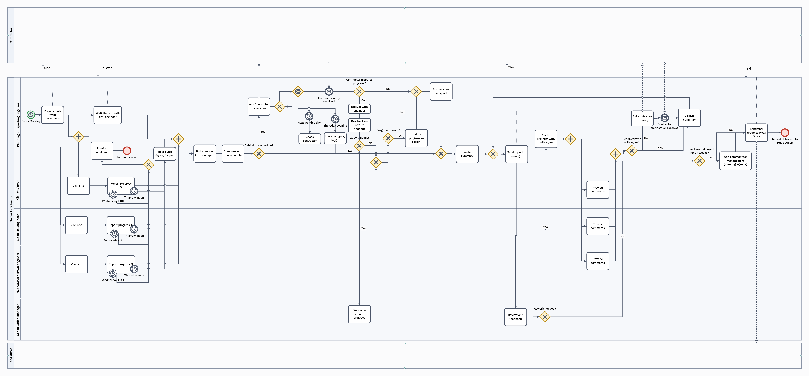

# Weekly progress report: AS-IS in BPMN

A BPMN 2.0 model of a weekly progress report on an industrial construction project, modelled from memory while studying Business Process Management at NOVA IMS. It covers the reporting side of a Planning & Reporting Engineer's role.

**Interactive model:** https://stanislavsidorovich.github.io/weekly-report-bpmn/ (opens in [Quaera Flow](https://flow.quaera.app): zoom, pan, click any element).

## Four parts, Monday to Friday

1. **Mon–Wed:** progress is collected in parallel from three discipline engineers and a site walk; reminder on Wednesday, cut-off Thursday noon.
2. **Behind schedule:** the contractor is asked for reasons; disputed numbers are discussed and re-checked on site.
3. **Thursday:** summary, review by the construction manager, remarks closed with colleagues first.
4. **Friday:** final report to head office; delays of 2+ weeks go on the management meeting agenda.

## Files

- `model.png`: the whole diagram.
- `weekly-report.flow.json`: the model; open it in Quaera Flow with File → Open.

The employer is not named and labels are simplified. Next in the course: analysis, simulation and a TO-BE redesign.
